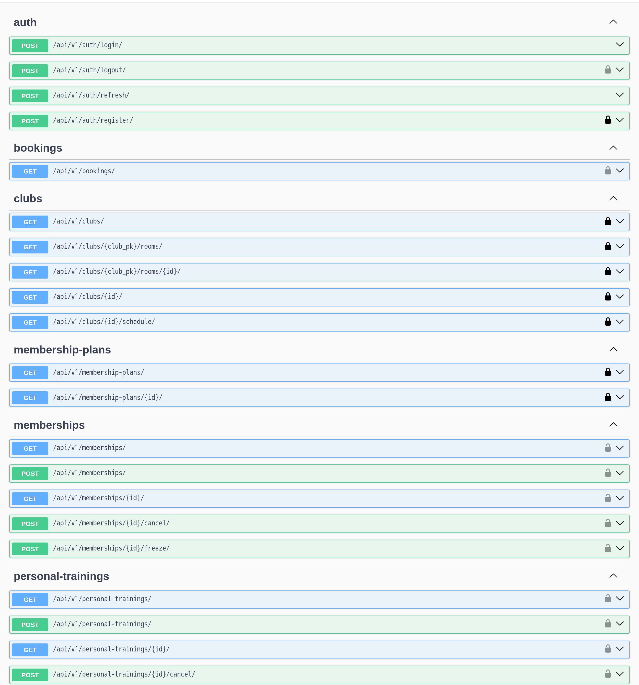
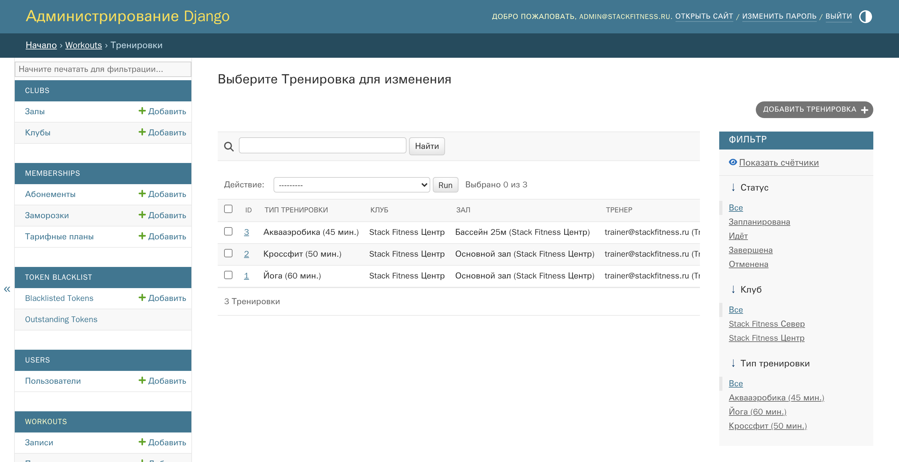
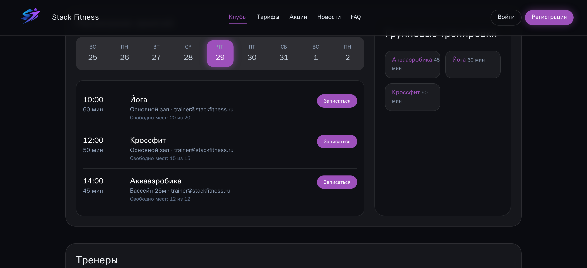
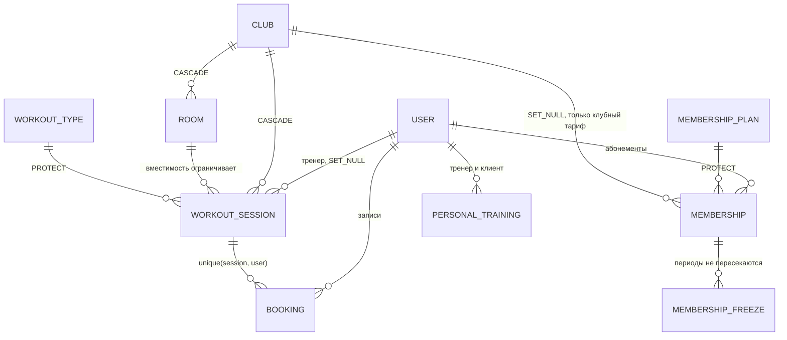

# Stack Fitness — API сети фитнес-клубов

REST API для сети фитнес-клубов: расписание занятий, абонементы с заморозкой,
запись на групповые и персональные тренировки. Учебный пет-проект. 

[](https://github.com/lanmast88/fitness-clubs-platform/actions/workflows/ci.yml)


31 эндпоинт, схема OpenAPI генерируется из кода вьюх:



## Стек

- **Python 3.14, Django 6, DRF** — ViewSet-ы и роутеры, вложенный маршрут `/clubs/{club_pk}/rooms/` на drf-nested-routers.
- **PostgreSQL 16** — основная БД, psycopg 3.
- **SimpleJWT + token_blacklist** — access/refresh, logout кладёт refresh в чёрный список.
- **drf-spectacular** — OpenAPI 3 и Swagger UI без ручного описания схемы.
- **uv** — лок-файл зависимостей, из него же генерируется `requirements.txt` для образа.
- **Docker, gunicorn, WhiteNoise** — многостадийный образ, статика админки и Swagger без nginx.
- **GitHub Actions** — линт, тесты, сборка образа, сквозные сценарии Playwright.

## Как запустить

```bash
git clone https://github.com/lanmast88/fitness-clubs-platform.git
cd fitness-clubs-platform
cp .env.example .env         
docker compose up --build
docker compose exec backend python manage.py seed_demo
```

- API — http://localhost:8000/api/v1/
- Swagger — http://localhost:8000/api/v1/schema/docs/
- Админка — http://localhost:8000/admin/ (`admin@stackfitness.ru` / `admin12345`)
- Фронтенд — http://localhost:5173

Переменные окружения — в `.env.example`: `SECRET_KEY`, `DEBUG`, `ALLOWED_HOSTS`,
`CORS_ALLOWED_ORIGINS`, доступы к базе и публикуемые порты. Для продакшена ключ
генерируется отдельно: `python -c "from django.core.management.utils import get_random_secret_key as k; print(k())"`.
Альтернатива Compose — Dev Container: «Reopen in Container» сам ставит
зависимости, мигрирует и сеет демо-данные.

## Что внутри

**Инварианты расписания держу в `clean()` моделей.** Пересечения у тренера и у
зала, вместимость сессии против вместимости зала, принадлежность зала клубу,
непересекающиеся заморозки — это правила про несколько полей и соседние строки,
в валидаторе одного поля им места нет. Админка и ORM получают их бесплатно, а
API-слой проверяет то же самое в сериализаторах, потому что DRF не вызывает
`full_clean()`. Дублирование осознанное: сериализатор отдаёт 400 с полем-причиной,
модель защищает запись из админки.



**Схема записи и схема ответа разделены.** `MembershipCreateSerializer` принимает
только `plan` и `club` — даты и статус считает бэкенд. Ответ `CreateModelMixin`
в таком случае не содержит ни `id`, ни вложенного тарифа, поэтому разделение
вынес в `CreateWithReadSerializerMixin`. Там же, в слое сериализаторов, лечится
пустой телефон: поле необязательное и уникальное, а DRF на пустой строке не
запускает `UniqueValidator` — второй пользователь с `phone=''` падал с
IntegrityError, то есть 500 вместо 400. Поймал тестом, привожу к NULL.

**Доступ считаю от `request.user`, а не от параметров запроса.** Пользователь
кастомный: вход по email, роль в поле `role`. Пишущие действия закрыты
`IsClient`, выборки абонементов, записей и персональных тренировок отфильтрованы
по текущему пользователю — чужой объект недостижим даже по прямому id.

**Расписание отдаёт ISO-8601, а не готовую строку времени.** Форматирование под
часовой пояс — задача клиента, иначе одно занятие показывается по-разному в
разных разделах. Плоский ответ собирает отдельный `Serializer`, запрос идёт
с `select_related` и `prefetch_related`.



**DevOps.** Образ многостадийный: колёса собираются в builder, в рантайм едут
только venv и libpq, процесс идёт от непривилегированного пользователя.
`requirements.txt` — артефакт `uv export`, CI падает, если он разошёлся с
`uv.lock`. Пайплайн гоняет ruff, `makemigrations --check`, тесты на
PostgreSQL-сервисе, сборку образа со смоук-проверкой, что контейнер отвечает и
работает не от root, и E2E на собранном фронтенде.



## Тесты

```bash
cd backend
uv run python manage.py test     # 115 тестов
uv run ruff check .
```

Покрыт HTTP-слой: коды ответов, права по ролям, валидация тел запросов, изоляция
чужих данных, граничные случаи вроде записи на заполненное занятие и заморозки с
пересечением. Тестов на модели напрямую нет — пересечения у тренера и зала живут
в `clean()`, через API недостижимы и проверками не закрыты. Админка не покрыта.
У фронтенда 7 смоук-сценариев Playwright, их гоняет CI.

## Ограничения

- **Инварианты только в Python.** Из бизнес-правил в БД закреплено одно —
  `unique(session, user)`.
  Проверка свободных мест читает счётчик и потом пишет — под параллельными
  запросами занятие можно переполнить.
- **Write-API для расписания нет.** Занятия и залы заводятся через админку,
  клиентские эндпоинты их только читают. Фильтрация идёт по UTC-дате, хотя
  у клуба есть поле `timezone`.
- **Нет пагинации, фильтров и поиска.** Списки отдаются целиком: на демо-данных
  незаметно, на реальных объёмах так нельзя.
- **Нет продакшен-профиля.** gunicorn без nginx и TLS, `manage.py check --deploy`
  сообщает о незакрытых `SECURE_SSL_REDIRECT`, `SECURE_HSTS_SECONDS` и
  `SESSION_COOKIE_SECURE`.


